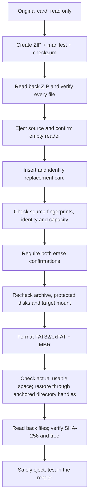

<p align="center">
  
</p>

<h1 align="center">InkKit</h1>

<p align="center">
  <strong>A native macOS app for your CrossInk reader.</strong><br>
  Edit settings, keep complete configuration backups and restore earlier snapshots.
</p>

<p align="center">
  <a href="https://github.com/gh-slee/inkkit/actions/workflows/tests.yml"></a>
  <a href="#native-settings-app-development"></a>
  <a href="#tech-stack"></a>
  <a href="#quick-start"></a>
  <a href="#tech-stack"></a>
  <a href="LICENSE"></a>
  <a href="#project-status"></a>
</p>

<p align="center">
  <a href="#quick-start">Quick start</a> ·
  <a href="#macos-app-screenshots">Screenshots</a> ·
  <a href="#supported-devices">Devices</a> ·
  <a href="#migration-cli">Migration CLI</a> ·
  <a href="#documentation">Documentation</a> ·
  <a href="CONTRIBUTING.md">Contribute</a>
</p>

**InkKit is an open-source native macOS app for managing CrossInk settings on your XTEINK reader's current SD card.** Adjust display and reading preferences, manage Wi-Fi/OPDS/sync configuration, and back up or restore complete configurations from a SwiftUI interface. The existing Python CLI handles full-card backup and migration separately.

**App status: development build.** Build it locally from `main`; there is no public
app installer or signed/notarized download yet. The published **v1.0.0 is the
migration CLI release**, and does not include the app.


*Actual native app with synthetic example data. [Browse the app gallery](docs/screenshots.md).*

| In the macOS app | What you can do |
| --- | --- |
| **Adjust reader settings** | Edit display, reading, library, controls, status bars and device preferences, with model-aware controls. |
| **Manage connection settings** | Add, edit or remove Wi-Fi networks and OPDS servers, and edit reading-sync preferences. This configures the card; it does not test network connections. |
| **Set font and dictionary preferences** | Configure font rendering and select assets already installed on the card. |
| **Keep complete configuration backups** | Back up all six global stores, browse timestamped local history, restore an older compatible snapshot or confirm deletion of a local backup. |
| **Review before writing** | Inspect changes, preserve the original state, verify saved bytes and eject the card safely. New or retained plaintext credentials need explicit consent for each write. |

The audited app profile covers **CrossInk v1.6.1** on **X3, X4, X4 Classic and X4 Pro**.
Only X3 has limited owner-reported physical acceptance; other models remain
untested. [Support policy](docs/firmware-support.md) · [Validation evidence](docs/configuration-validation.md).
This project is not affiliated with XTEINK, CrossInk or CrossPoint.

## Quick start

### Build and open the macOS app

Requirements: **macOS 14+**, Command Line Tools with Swift and a macOS 14+ SDK,
and the **python.org CPython 3.12 framework**. This local development build targets
the build host's CPU; Intel and clean-Mac distribution checks remain pending.

```bash
git clone https://github.com/gh-slee/inkkit.git
cd inkkit
python3 scripts/build_macos_preview.py --output work/macos-config
open -n 'work/macos-config/InkKit Preview.app'
```

Run the builder with the python.org CPython 3.12 interpreter; if `python3` selects
another installation, use that interpreter's path instead. Choose a fresh output
directory for each build: the builder preserves existing app bundles. The app
bundles its runtime, so launching the built app does not require Python on PATH.
See [complete build instructions and packaging limits](docs/macos-preview.md).

1. Choose **Create synthetic demo** to explore the app without a card.
2. For your reader, keep a separate verified full-card backup, shut down the reader
   and insert its card into a separate SD reader. Choose **Open SD card**, select
   the mounted root and confirm the actual model and firmware version.
3. Use **Backups → Backup now** before editing. Change one preference, review it
   and choose **Back up & apply**. After **Eject** succeeds, return the card to the
   shut-down reader and verify the result there.

The app edits settings on the current card; it never formats a disk. To replace
an entire SD card, use the [migration CLI](#migration-cli).

## Native settings app (development)

<!-- configuration-summary:start -->
Development source includes a native macOS configuration app for **CrossInk v1.6.1**.
It opens an explicitly selected current SD card and supports **148 main-setting controls**,
plus up to **8 Wi-Fi networks, 8 OPDS servers, reading-sync preferences, 24 TTF profiles
and the global dictionary selection**. Controls follow the selected model: X3 121, X4 112, X4 Classic 122, X4 Pro 132 editable main controls in a fresh profile. Older tilt schemas require firmware migration first.

Review, complete six-store Mac-side backups, verified apply, guarded restore and safe eject
are implemented. Backups supports Backup now, newest-first history, reviewed restore and confirmed deletion.
New or retained plaintext passwords require explicit consent for each write.
The app is a **development build with limited owner-reported X3 settings acceptance**.
Restore, safe eject and tested preferences including Sleep Screen worked on X3; other settings/models remain unvalidated.
There is no signed/notarized app download; v1.0.0 remains the migration CLI release.

See the [configuration reference](docs/configuration-reference.md) for every control and limitation,
and [build/use instructions](docs/macos-preview.md). The app does not format cards, flash firmware,
execute sync/network operations or install font/dictionary assets.
<!-- configuration-summary:end -->

### Ongoing firmware and device support

InkKit aims to track future CrossInk releases and XTEINK readers. The native app
loads reviewed firmware/model choices and hardware capabilities from its bundled
backend catalogue. The currently audited contract is **CrossInk v1.6.1** for X3,
X4, X4 Classic and X4 Pro. Unsupported hardware pages are hidden where appropriate:
X3, X4 and X4 Classic have no Frontlight page; X4 Pro has it.

New releases/devices need an upstream settings/capability review, schema/codec
changes where needed and compatibility tests before configuration writes are
enabled. Unknown versions are not silently treated as the nearest supported
version. The opaque migration CLI remains available for backups/diagnostics when
its independent card/layout checks pass. See the [support policy](docs/firmware-support.md).

### Complete configuration backups

**Backups → Backup now** captures all six global configuration stores together.
Local history is sorted newest first, including timestamp, model and backup scope.
Restore reviews the current state and preserves a complete pre-restore backup;
Delete asks for confirmation. Older compatible complete snapshots can be restored
after fresh review, even after later changes. Existing single-file backups remain
available with a **Legacy single file** label; they keep their original strict
restore checks and are not presented as complete snapshots.

Each native Apply also saves a complete snapshot before its existing single-file
transaction. Backups stay in private Mac-side storage and may contain credentials.
They contain settings, not books, installed font/dictionary assets or per-book
state. The existing full-card ZIP workflow and its repo-local backup location are
unchanged. See [backup/recovery details](docs/macos-preview.md#complete-configuration-backups).

### What has actually been verified

The controls use CrossInk's real storage formats. **Synthetic demo** is invented
example data; **Open SD card** uses real, reviewed configuration-file writes.
File readback proves saved bytes, not that firmware loaded them or a connection
succeeded. The maintainer has reported successful X3 Restore, safe eject and tested
preference changes, including Sleep Screen behavior on the reader. The tested
preferences were not fully itemized; this does not certify every control or model.

See [source-audit evidence and X3 acceptance gates](docs/configuration-validation.md).

### macOS app screenshots

Native app with synthetic example data. These captures document the development
UI; hardware evidence is recorded separately above.

| Display | Reading |
| --- | --- |
|  |  |
| Wi-Fi | Complete configuration backups |
|  |  |

See the [complete native app gallery](docs/screenshots.md) for Library, Controls,
Status bars, Device, Wi-Fi, OPDS, reading sync, fonts, dictionary, review and the
X4 Pro-only Frontlight page. All shown names/URLs are invented examples.


## Migration CLI

The existing Python CLI backs up, migrates and verifies entire microSD cards,
preserving books, ordinary and hidden files, the reader's directory layout and
saved state with SHA-256 checks. It runs with Python's standard library, without
an account, network connection or third-party Python package. Its stable entry
point and legacy backup format are unchanged.

> **A full migration or normal `--restore` permanently erases the entire selected target disk after both confirmations.** Keep the original card disconnected and intact until you have tested the replacement in your reader. Read the target information and both erase confirmations carefully. `--resume` never formats; read-only commands are described below.

### Migration features

| | What you can do |
| --- | --- |
| 📚 **Keep your reading data** | Preserve books, hidden `.crosspoint/` data, fonts, bookmarks, reading history and progress, including unfamiliar hidden reader directories. |
| 🗄️ **Back up before erasing** | Create a timestamped ZIP, paired manifest and independent checksum, then read back every archived file before ejecting the source. |
| 🔍 **Inspect first** | Verify an existing backup without a card, or run a read-only target preflight before migration. |
| 🔄 **Recover an interruption** | Inspect a journal-bound target and resume missing bytes without formatting or replacing existing data. |
| 🛡️ **Confirm the physical target** | Check removable-media identity, source fingerprints, protected storage, physical mount ownership and capacity before the guarded erase. |
| 💾 **Choose the card format** | Use capacity-based FAT32/exFAT + MBR defaults, explicit overrides or the source filesystem policy. |
| ✅ **Verify the replacement** | Re-read restored bytes and compare SHA-256, file counts and directory trees. |
| 🔒 **Keep backups local** | Store backups beside the script in a Git-ignored folder; publication hooks and CI add a separate source-only guard. |

### Run the published CLI

CLI requirements: **macOS**, **Python 3.9+**, an SD card reader, the original CrossInk/CrossPoint card, and a separate replacement card. Git is needed only to clone or contribute. Do not use your only copy of important data as a test card.

The commands below select the published [v1.0.0 source](https://github.com/gh-slee/inkkit/releases/tag/v1.0.0),
released under the former XTEINK SD Migrator name. Its banner uses the original
name; the commands and backup format are unchanged. You can also download the
source ZIP or tar.gz there and extract the entire folder. For InkKit development
source and contributor setup, see [Development](docs/development.md).

```bash
git clone --branch v1.0.0 https://github.com/gh-slee/inkkit.git
cd inkkit

python3 xteink_sd_migrate.py --version
python3 xteink_sd_migrate.py --diagnose
python3 xteink_sd_migrate.py --backup-only
```

When you are ready for a full migration:

```bash
python3 xteink_sd_migrate.py
```

1. Shut down your reader, insert only the **original** card through the card reader, and confirm the source volume.
2. Wait for the ZIP creation and read-back verification to finish. Preserve all three backup files.
3. After the source is ejected, remove it and confirm the reader is empty. Insert the replacement card when prompted. The same reader may reuse the same `diskN` number.
4. Check the target device, bus, capacity and mount. Type both `ERASE diskN` and `WIPE TARGET` only for the intended replacement.
5. Wait for format, restore, SHA-256 verification and safe eject. Test books, fonts, bookmarks and progress on your reader before retiring the original card.

Cancel with `q` at disk selection or Ctrl-C before formatting. Cancellation after formatting begins cannot undo deletion. A failed restore may leave an incomplete target; keep the original and verified backup and follow the [recovery guide](docs/troubleshooting.md).

The tool only erases **confirmed writable removable USB/SD media with one mounted FAT32/exFAT volume, a readable volume UUID and capacity <=2 TiB**. Fixed HDDs/SSDs, internal non-removable disks, virtual disks, Time Machine, APFS and unknown, unmounted or multi-partition targets are blocked. Some legitimate readers may be rejected. A running reader’s USB mass-storage mode is not hardware-validated; use a separate SD reader. Do not bypass a rejection or blindly reformat another disk.

<details>
<summary><strong>Restore an existing backup or choose a filesystem</strong></summary>

```bash
python3 xteink_sd_migrate.py --restore "$PWD/xteink-x3-backup/EXAMPLE.zip"
python3 xteink_sd_migrate.py --verify-backup "$PWD/xteink-x3-backup/EXAMPLE.zip"
python3 xteink_sd_migrate.py --restore "$PWD/xteink-x3-backup/EXAMPLE.zip" --dry-run
python3 xteink_sd_migrate.py --filesystem exfat
python3 xteink_sd_migrate.py --filesystem fat32
python3 xteink_sd_migrate.py --filesystem source
python3 xteink_sd_migrate.py --allow-smaller-target
python3 xteink_sd_migrate.py --help
```

Restore verifies the existing ZIP and manifest, then follows the same destructive target-selection workflow. `--filesystem source` preserves a recognized source FAT32/exFAT format. `--allow-smaller-target` explicitly relaxes only the raw-capacity comparison; data-fit and actual usable-space checks still apply.

</details>

### Verify, preview, and recover with the CLI

| Command | Behavior |
| --- | --- |
| `--verify-backup BACKUP.zip` | Read the paired manifest, whole ZIP hash, every entry and every file hash. No SD card, disk query, journal or eject operation. |
| `--restore BACKUP.zip --dry-run` | Verify the backup; prompt for an empty reader and replacement card; check identity, source/protected storage, capacity and format limits. No formatting, copying, backup creation, journal or eject operation. |
| `--check-restore BACKUP.zip` | Inspect the recorded interrupted target and report complete, missing, partial, conflicting and unexpected entries. Read only. |
| `--resume BACKUP.zip --dry-run` | Same read-only recovery inspection. |
| `--resume BACKUP.zip` | Require the matching local journal, recorded target volume and `RESUME diskN` confirmation. Append verified remaining bytes and create missing files, then fully verify and eject. Never formats. |

`--dry-run` requires an existing backup with `--restore` or `--resume`; use
`--backup-only` first if needed. A successful preflight is an estimate: actual free
space, created filesystem and MBR are checked after a future format, and all guards
and both erase confirmations run again for the real restore.

New restore jobs save a private local journal beside the ZIP before copying. Recovery
checks all existing bytes, including a partial file's entire prefix, before appending.
Complete files keep their contents and timestamps. Unexpected or mismatching data
stops recovery. Older interrupted jobs without a journal cannot be automatically
resumed. Keep the original and backup; see the [recovery guide](docs/troubleshooting.md).

## Supported devices

InkKit's current XTEINK device scope is **X3, X4, X4 Classic and X4 Pro running CrossInk**.
[CrossInk’s supported-device list](https://crossink.dev/installation.html), checked
2026-10-22, lists these models. Its [SD layout documentation](https://crossink.dev/data-cache.html)
describes the shared `.crosspoint` directory. InkKit detects that layout and copies
opaque file bytes; it does not inspect a model number or flash firmware.
CrossInk also supports Seeed Studio Sticky; that non-XTEINK device is outside
InkKit's current supported workflow.

| Reader / environment | Migration scope | Hardware evidence |
| --- | --- | --- |
| XTEINK X3 running CrossInk | Supported file-level workflow | [Reviewed 32 GB to 16 GB FAT32 result](docs/hardware-validation.md#reviewed-x3-result-2026-10-22) on hardware-tested revision `505c1c5` |
| XTEINK X4 running CrossInk | Supported file-level workflow | Physical migration pending |
| XTEINK X4 Classic running CrossInk | Supported file-level workflow | Physical migration pending |
| XTEINK X4 Pro running CrossInk | Supported file-level workflow | Physical migration pending |
| Other XTEINK models supported by CrossInk | In scope when they expose the same mounted SD layout and pass every safety check | Validate the exact model, firmware, card and reader combination |
| CrossPoint or downstream firmware with the same layout | Layout-compatible candidate | Firmware-specific validation pending |
| Stock firmware, a different storage layout, Linux / Windows hosts | Outside the supported workflow | No support claim |

“Supported workflow” describes implementation scope, not a hardware certification. The data cannot conclusively identify an XTEINK model, and firmware support does not guarantee that a reader/card passes macOS disk-safety checks. The intended use is **replacing the card for a reader**, not translating settings or display caches between different models or firmware builds. See the [compatibility guide](docs/compatibility.md).

<a id="how-it-works"></a>

## How migration works



This is **file-level migration**, not `dd` or a raw clone. It does not copy boot sectors, partition geometry, unused sectors or firmware. Formatting and eject show elapsed time; byte-processing stages show progress, counts and rates. The original card and backup are retained after success.

## Filesystem and capacity policy

| Target’s actual raw capacity | Default format |
| --- | --- |
| At most 32 GiB | FAT32 + MBR |
| Greater than 32 GiB | exFAT + MBR |

This is a project default, **not a guarantee of filesystem support by every firmware build**. FAT32 limits individual files to 4 GiB minus one byte. exFAT avoids that limit, but compatibility varies. The tool confirms the actual filesystem and MBR after formatting; GPT is rejected for restore.

The target must normally be at least as large as the source in actual bytes. Cards with the same marketed size can differ. Allocation overhead and a reserve are estimated before erase. Actual free space is checked after format and before copying; failure at that stage leaves an erased target and preserves the original and backup.

## Backups and privacy

**App configuration snapshots** stay in private Mac-side storage under
`~/Library/Application Support/InkKit/ConfigurationBackups/`. They cover six global
settings stores, not books or assets; they may contain credentials and are not
encrypted. See [complete configuration backups](#complete-configuration-backups).

**Full-card CLI backups** go to **`xteink-x3-backup/` beside `xteink_sd_migrate.py`**, independent of your Terminal’s current directory. The historical `x3` spelling is a compatibility name, **not a model restriction**. Existing backups stay where they are.

| File | Purpose |
| --- | --- |
| `xteink-x3_YYYY-MM-DD_HH-MM-SS-microseconds.zip` | Books, hidden configuration and reader data |
| Same basename `.manifest.json` | Relative paths, sizes, timestamps, source metadata and per-file SHA-256; required for restore |
| `.zip.sha256` | Independent archive checksum; retain alongside the other files |
| `.restore-state.json` | Private local job journal for a new/incomplete restore; keep with the ZIP until recovery completes |
| `.restore.lock` | Private local concurrency lock; an empty lock file may remain after success |

Restore requires the ZIP and matching manifest. The checksum sidecar is retained for separate verification, for example `shasum -a 256 -c EXAMPLE.zip.sha256` inside the backup directory. The `xteink-x3-migrate-v1` schema and v1.6 backups remain supported across the model-neutral tool.

Backups can contain Wi-Fi, OPDS and synchronization credentials and copyrighted books. **They are not encrypted.** Files are created with private permissions, which FAT/exFAT may not enforce. Protect your local storage and retain an off-device copy. The tool does not upload data or contact GitHub during migration.

The backup folder, ZIPs, manifests, checksums, restore journals/locks, reader data and private settings are Git-ignored. Ignore rules do not protect already tracked files. Repository-local hooks and CI use an explicit publication allowlist and credential-pattern checks; they reduce accidental disclosure but cannot prove that every personal value is absent. Never force-add backups or attach them to public issues. See [publication safeguards](docs/publishing.md) and [security policy](SECURITY.md).

<details>
<summary><strong>Verification guarantees and macOS exclusions</strong></summary>

Every archived/restored file is read back and SHA-256 checked; file and directory trees must match. Checksums establish consistency with captured bytes, not original source health, long-term hardware reliability, or authenticity against someone who can modify both ZIP and manifest.

Only these macOS service entries are excluded:

- Root entries: `.Trashes`, `.Spotlight-V100`, `.fseventsd`, `.TemporaryItems`, `.DocumentRevisions-V100`, `.apdisk`, `.PKInstallSandboxManager-SystemSoftware`.
- Anywhere: `.DS_Store`, `.VolumeIcon.icns`, `.com.apple.timemachine.donotpresent` and names beginning `._`.

Other hidden data, including `.crosspoint/`, `.fonts/` and unfamiliar reader directories, is preserved. Links and special files are rejected. ZIP validation rejects traversal, duplicate/case/Unicode aliases, mismatched sizes and checksums, special entries and unreasonable resource usage. Limits: 200,000 entries, 2 TiB uncompressed data, 128 MiB manifest/central-directory metadata, expansion ratio <=10,000. See [safety](docs/safety.md).

</details>

## Tech stack

| Layer | Technology |
| --- | --- |
| macOS interface | SwiftUI + AppKit; Swift 5 language mode, local macOS 14+ build for the build host CPU |
| Migration CLI | Direct Python 3.9+ script; no package installation |
| Configuration core | Python 3.9+ standard library; six pinned CrossInk stores, model-aware schema and validation |
| App/helper boundary | Versioned JSON over stdin/stdout pipes; no local web server or runtime AI dependency |
| App runtime | Bundled CPython 3.12 development runtime; runs without Python on PATH |
| Configuration recovery | Private Mac-side original-file snapshots, SHA-256, no-follow descriptors, stale-token checks and guarded restore |
| macOS storage | Read-only `diskutil` property lists and safe eject for the app; guarded erase belongs only to the separate migration CLI |
| Backup and integrity | Standard-library `zipfile`, JSON, `hashlib` SHA-256 |
| Restore safety | Directory descriptors, no-follow paths, exclusive file creation, disk/mount checks |
| Verification | `unittest`, temporary synthetic files and mocked disk commands |
| App distribution | Local ad-hoc-signed `.app`; no public installer, Developer ID signature or notarization yet |
| Contributor privacy | Standard-library publication guard, local Git hooks, GitHub Actions |

The CLI has no third-party runtime dependencies. The optional local app bundles its
runtime. Neither workflow uses Docker, a web frontend, telemetry or an AI service.
The project icon is original SVG artwork; [asset provenance](assets/readme/README.md).

## Project status

Formerly **XTEINK SD Migrator**. The repository is now `gh-slee/inkkit`; the stable
`xteink_sd_migrate.py` entry point, existing backup names/format and repo-local backup
directory remain compatible. The published `v1.0.0` source retains the original
branding; the InkKit branding is in development source until a later release.

**Published migration release: [v1.0.0](https://github.com/gh-slee/inkkit/releases/tag/v1.0.0)**,
originally released as XTEINK SD Migrator. InkKit development source keeps the same
1.0.0 version constant while the rebrand is unreleased; startup/`--version` show the
name of the checked-out source. The existing tag is unchanged. The native configuration app is unreleased
development source, with limited owner-reported X3 settings acceptance and broader
configuration validation pending.
[CHANGELOG.md](CHANGELOG.md) separates unreleased changes
from published snapshots.

| Area | Evidence / boundary |
| --- | --- |
| Migration behavior | Existing v1.6 behavior and legacy backup compatibility preserved |
| Model-independent operation | Synthetic hidden-data roundtrips for X3, X4, X4 Classic, X4 Pro and an invented future model label |
| Published release validation | [v1.0.0 exact-commit CI](https://github.com/gh-slee/inkkit/actions/runs/39847722957) on `ef927dc`: 166 synthetic tests per macOS/Python 3.9 and 3.12 job, compilation, CLI smoke checks and source-publication audits; later development commits require their own checks |
| Real hardware | [X3 backup, restore/readback, safe eject and owner-confirmed reader acceptance](docs/hardware-validation.md#reviewed-x3-result-2026-10-22) on revision `505c1c5`; other physical combinations pending |
| Configuration evidence | [Pinned-source audit, synthetic/IPC checks and limited X3 settings acceptance](docs/configuration-validation.md); expected X4-family capabilities remain physically untested |
| Safety boundaries | Conservative target gate may reject legitimate readers; hotplug races cannot be completely eliminated |

No real card is formatted by tests or CI. Additional hardware reports are welcome through the [hardware report template](https://github.com/gh-slee/inkkit/issues/new?template=hardware_report.md), following the [acceptance criteria](docs/hardware-validation.md). Partial and read-only reports are useful when clearly labeled; automated success is not proof that a particular physical device has been migrated.

**Hardware evidence:** [X3 acceptance](docs/hardware-validation.md#reviewed-x3-result-2026-10-22)
completed for one 32 GB to 16 GB FAT32/MBR configuration. The report records its
hardware-tested revision and the metadata-only differences in the final v1.0.0
source. X4 and other compatible models retain file-level support with physical
validation pending; their reports were not required for v1.0.0. The
[v1 compatibility commitment](docs/compatibility.md#v1-compatibility-commitment) and
[release checks](docs/publishing.md#manual-stable-release-preparation) continue to
apply to future versions. Native settings features have separate configuration
acceptance gates; passing migration checks does not validate them.

## Documentation

| Guide | Read it for… |
| --- | --- |
| [macOS app](docs/macos-preview.md) · [Screenshots](docs/screenshots.md) | Build and use the development app; browse the native interface |
| [Configuration reference](docs/configuration-reference.md) · [Validation](docs/configuration-validation.md) | Supported controls, pinned source evidence and hardware acceptance limits |
| [Firmware support](docs/firmware-support.md) · [Architecture](docs/config-architecture.md) | Reviewed version/device catalogue and configuration transaction design |
| [Compatibility](docs/compatibility.md) | Device scope, firmware/layout assumptions and validation evidence |
| [Hardware validation](docs/hardware-validation.md) | Sanitized reports, acceptance criteria and evidence needed for stable release review |
| [Safety](docs/safety.md) | Erase guards, integrity checks and remaining limits |
| [Troubleshooting](docs/troubleshooting.md) | `diskutil info -plist diskN`, detection, macOS permissions, capacity failures and recovery |
| [Contributing](CONTRIBUTING.md) · [Development](docs/development.md) | Local setup, tests, CI and project maintenance |
| [Publication](docs/publishing.md) · [Security](SECURITY.md) | Private backups, index/history audits and vulnerability reports |
| [Shared project instructions](AGENTS.md) · [Agent setup](docs/agent-development.md) · [Changelog](CHANGELOG.md) | Development boundaries and version history |

For help, [open an issue](https://github.com/gh-slee/inkkit/issues/new/choose) with a minimal synthetic reproduction and sanitized errors. Exit codes: 0 success; 1 operational error; 2 invalid CLI options; 130 interruption.

## Development

```bash
python3 scripts/install_git_hooks.py
XTEINK_TESTING=1 python3 -m unittest discover -s tests -v -b
python3 -m compileall -q xteink_sd_migrate.py disk_safety.py restore_recovery.py inkkit_config.py inkkit_helper.py inkkit_codec.py inkkit_schema.py crossink_profile.py inkkit_volume.py inkkit_snapshots.py scripts tests
python3 scripts/check_publication.py --worktree
python3 scripts/check_publication.py --staged
python3 scripts/check_publication.py --all-history
```

Git hooks are installed only in this checkout. Tests use disposable synthetic fixtures; `XTEINK_TESTING=1` blocks the disk mutation runner. Real destructive testing is a separate, voluntary session using an explicitly designated disposable card. Development agents are optional and are not runtime dependencies.

## Support this project

If you find this project useful, consider [sponsoring on GitHub](https://github.com/sponsors/gh-slee) to support ongoing development, bug fixes, testing, documentation, and maintenance.

Sponsorship is entirely optional. All features remain free and open source.

## License

Code, documentation and original artwork are [MIT licensed](LICENSE). Python and macOS tools retain their own licenses. Reader firmware and user-owned books/data are not distributed by this project.
