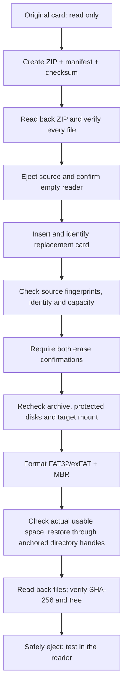

<p align="center">
  
</p>

<h1 align="center">XTEINK SD Migrator</h1>

<p align="center">
  <strong>A new card. The same reading life.</strong><br>
  Back up, migrate, and verify your CrossInk reader’s books, fonts, settings, and progress.
</p>

<p align="center">
  <a href="https://github.com/gh-slee/xteink-sd-migrator/actions/workflows/tests.yml"></a>
  <a href="#tech-stack"></a>
  <a href="#quick-start"></a>
  <a href="#tech-stack"></a>
  <a href="LICENSE"></a>
  <a href="#project-status"></a>
</p>

<p align="center">
  <a href="#quick-start">Quick start</a> ·
  <a href="#supported-devices">Devices</a> ·
  <a href="#how-it-works">How it works</a> ·
  <a href="#documentation">Documentation</a> ·
  <a href="CONTRIBUTING.md">Contribute</a>
</p>

**XTEINK SD Migrator is an open-source macOS CLI for replacing the microSD card in a CrossInk-compatible XTEINK reader.** It copies ordinary and hidden files, preserves the reader’s directory layout, and verifies the backup and restored data with SHA-256. No installation, account, network connection, or third-party Python package is needed to run it.

**Beta:** the implementation is model-independent; physical migration evidence is one successful X3/Mac migration with its internal v1.6 predecessor. X4 and other compatible XTEINK models are in scope, with additional hardware validation pending. This project is not affiliated with XTEINK, CrossInk, or CrossPoint.

> **A full migration or normal `--restore` permanently erases the entire selected target disk after both confirmations.** Keep the original card disconnected and intact until you have tested the replacement in your reader. Read the target information and both erase confirmations carefully. `--resume` never formats; read-only commands are described below.

## Features

| | What you can do |
| --- | --- |
| 📚 **Keep your reading data** | Preserve books, hidden `.crosspoint/` data, fonts, bookmarks, reading history and progress, including unfamiliar hidden reader directories. |
| 🗄️ **Back up before erasing** | Create a timestamped ZIP, paired manifest and independent checksum, then read back every archived file before ejecting the source. |
| 🔍 **Inspect first** | Verify an existing backup without a card, or run a read-only target preflight before migration. |
| 🔄 **Recover an interruption** | Inspect a journal-bound target and resume missing bytes without formatting or replacing existing data. |
| 🛡️ **Confirm the physical target** | Check removable-media identity, source fingerprints, protected storage, physical mount ownership and capacity before the guarded erase. |
| 💾 **Choose the card format** | Use capacity-based FAT32/exFAT + MBR defaults, explicit overrides or the source filesystem policy. |
| ✅ **Verify the replacement** | Re-read restored bytes and compare SHA-256, file counts and directory trees. |
| 🔒 **Keep backups local** | Store backups beside the script in a Git-ignored folder; publication hooks and CI add a separate source-only guard. |

## Quick start

Requirements: **macOS**, **Python 3.9+**, an SD card reader, the original CrossInk/CrossPoint card, and a separate replacement card. Git is needed only to clone or contribute. Do not use your only copy of important data as a test card.

The commands below check out the published [v0.1.0-beta.3 prerelease](https://github.com/gh-slee/xteink-sd-migrator/releases/tag/v0.1.0-beta.3).
You can also download its source ZIP or tar.gz from that release page and extract
the entire source folder before running the script. Contributor setup is in
[Development](docs/development.md).

```bash
git clone --branch v0.1.0-beta.3 https://github.com/gh-slee/xteink-sd-migrator.git
cd xteink-sd-migrator

python3 xteink_sd_migrate.py --version
python3 xteink_sd_migrate.py --diagnose
python3 xteink_sd_migrate.py --backup-only
```

When you are ready for a full migration:

```bash
python3 xteink_sd_migrate.py
```

1. Shut down your reader, insert only the **original** card through the card reader, and confirm the source volume.
2. Wait for the ZIP creation and read-back verification to finish. Preserve all three backup files.
3. After the source is ejected, remove it and confirm the reader is empty. Insert the replacement card when prompted. The same reader may reuse the same `diskN` number.
4. Check the target device, bus, capacity and mount. Type both `ERASE diskN` and `WIPE TARGET` only for the intended replacement.
5. Wait for format, restore, SHA-256 verification and safe eject. Test books, fonts, bookmarks and progress on your reader before retiring the original card.

Cancel with `q` at disk selection or Ctrl-C before formatting. Cancellation after formatting begins cannot undo deletion. A failed restore may leave an incomplete target; keep the original and verified backup and follow the [recovery guide](docs/troubleshooting.md).

The beta only erases **confirmed writable removable USB/SD media with one mounted FAT32/exFAT volume, a readable volume UUID and capacity <=2 TiB**. Fixed HDDs/SSDs, internal non-removable disks, virtual disks, Time Machine, APFS and unknown, unmounted or multi-partition targets are blocked. Some legitimate readers may be rejected. A running reader’s USB mass-storage mode is not hardware-validated; use a separate SD reader. Do not bypass a rejection or blindly reformat another disk.

<details>
<summary><strong>Restore an existing backup or choose a filesystem</strong></summary>

```bash
python3 xteink_sd_migrate.py --restore "$PWD/xteink-x3-backup/EXAMPLE.zip"
python3 xteink_sd_migrate.py --verify-backup "$PWD/xteink-x3-backup/EXAMPLE.zip"
python3 xteink_sd_migrate.py --restore "$PWD/xteink-x3-backup/EXAMPLE.zip" --dry-run
python3 xteink_sd_migrate.py --filesystem exfat
python3 xteink_sd_migrate.py --filesystem fat32
python3 xteink_sd_migrate.py --filesystem source
python3 xteink_sd_migrate.py --allow-smaller-target
python3 xteink_sd_migrate.py --help
```

Restore verifies the existing ZIP and manifest, then follows the same destructive target-selection workflow. `--filesystem source` preserves a recognized source FAT32/exFAT format. `--allow-smaller-target` explicitly relaxes only the raw-capacity comparison; data-fit and actual usable-space checks still apply.

</details>

### Verify, preview, and recover

| Command | Behavior |
| --- | --- |
| `--verify-backup BACKUP.zip` | Read the paired manifest, whole ZIP hash, every entry and every file hash. No SD card, disk query, journal or eject operation. |
| `--restore BACKUP.zip --dry-run` | Verify the backup; prompt for an empty reader and replacement card; check identity, source/protected storage, capacity and format limits. No formatting, copying, backup creation, journal or eject operation. |
| `--check-restore BACKUP.zip` | Inspect the recorded interrupted target and report complete, missing, partial, conflicting and unexpected entries. Read only. |
| `--resume BACKUP.zip --dry-run` | Same read-only recovery inspection. |
| `--resume BACKUP.zip` | Require the matching local journal, recorded target volume and `RESUME diskN` confirmation. Append verified remaining bytes and create missing files, then fully verify and eject. Never formats. |

`--dry-run` requires an existing backup with `--restore` or `--resume`; use
`--backup-only` first if needed. A successful preflight is an estimate: actual free
space, created filesystem and MBR are checked after a future format, and all guards
and both erase confirmations run again for the real restore.

New restore jobs save a private local journal beside the ZIP before copying. Recovery
checks all existing bytes, including a partial file's entire prefix, before appending.
Complete files keep their contents and timestamps. Unexpected or mismatching data
stops recovery. Older interrupted jobs without a journal cannot be automatically
resumed. Keep the original and backup; see the [recovery guide](docs/troubleshooting.md).

## Supported devices

[CrossInk’s supported-device list](https://crossink.dev/installation.html) includes **X3, X4, X4 Classic and X4 Pro**. Its [SD layout documentation](https://crossink.dev/data-cache.html) describes the shared `.crosspoint` directory used for reader data. This tool detects that layout and copies opaque file bytes; it does not inspect a model number or flash model-specific firmware.

| Reader / environment | Migration scope | Hardware evidence |
| --- | --- | --- |
| XTEINK X3 running CrossInk | Supported file-level workflow | One author-reported successful migration with internal v1.6 |
| XTEINK X4 running CrossInk | Supported file-level workflow | Physical migration pending |
| XTEINK X4 Classic / X4 Pro running CrossInk | Supported file-level workflow | Physical migration pending |
| Other XTEINK models supported by CrossInk | In scope when they expose the same mounted SD layout and pass every safety check | Validate the exact model, firmware, card and reader combination |
| CrossPoint or downstream firmware with the same layout | Layout-compatible candidate | Firmware-specific validation pending |
| Stock firmware, a different storage layout, Linux / Windows hosts | Outside the supported workflow | No support claim |

“Supported workflow” describes implementation scope, not a hardware certification. The data cannot conclusively identify an XTEINK model, and firmware support does not guarantee that a reader/card passes macOS disk-safety checks. The intended use is **replacing the card for a reader**, not translating settings or display caches between different models or firmware builds. See the [compatibility guide](docs/compatibility.md).

## How it works



This is **file-level migration**, not `dd` or a raw clone. It does not copy boot sectors, partition geometry, unused sectors or firmware. Formatting and eject show elapsed time; byte-processing stages show progress, counts and rates. The original card and backup are retained after success.

## Filesystem and capacity policy

| Target’s actual raw capacity | Default format |
| --- | --- |
| At most 32 GiB | FAT32 + MBR |
| Greater than 32 GiB | exFAT + MBR |

This is a project default, **not a guarantee of filesystem support by every firmware build**. FAT32 limits individual files to 4 GiB minus one byte. exFAT avoids that limit, but compatibility varies. The tool confirms the actual filesystem and MBR after formatting; GPT is rejected for restore.

The target must normally be at least as large as the source in actual bytes. Cards with the same marketed size can differ. Allocation overhead and a reserve are estimated before erase. Actual free space is checked after format and before copying; failure at that stage leaves an erased target and preserves the original and backup.

## Backups and privacy

New backups go to **`xteink-x3-backup/` beside `xteink_sd_migrate.py`**, independent of your Terminal’s current directory. The historical `x3` spelling is a compatibility name, **not a model restriction**. Existing backups stay where they are.

| File | Purpose |
| --- | --- |
| `xteink-x3_YYYY-MM-DD_HH-MM-SS-microseconds.zip` | Books, hidden configuration and reader data |
| Same basename `.manifest.json` | Relative paths, sizes, timestamps, source metadata and per-file SHA-256; required for restore |
| `.zip.sha256` | Independent archive checksum; retain alongside the other files |
| `.restore-state.json` | Private local job journal for a new/incomplete restore; keep with the ZIP until recovery completes |
| `.restore.lock` | Private local concurrency lock; an empty lock file may remain after success |

Restore requires the ZIP and matching manifest. The checksum sidecar is retained for separate verification, for example `shasum -a 256 -c EXAMPLE.zip.sha256` inside the backup directory. The `xteink-x3-migrate-v1` schema and v1.6 backups remain supported across the model-neutral tool.

Backups can contain Wi-Fi, OPDS and synchronization credentials and copyrighted books. **They are not encrypted.** Files are created with private permissions, which FAT/exFAT may not enforce. Protect your local storage and retain an off-device copy. The tool does not upload data or contact GitHub during migration.

The backup folder, ZIPs, manifests, checksums, restore journals/locks, reader data and private settings are Git-ignored. Ignore rules do not protect already tracked files. Repository-local hooks and CI use an explicit publication allowlist and credential-pattern checks; they reduce accidental disclosure but cannot prove that every personal value is absent. Never force-add backups or attach them to public issues. See [publication safeguards](docs/publishing.md) and [security policy](SECURITY.md).

<details>
<summary><strong>Verification guarantees and macOS exclusions</strong></summary>

Every archived/restored file is read back and SHA-256 checked; file and directory trees must match. Checksums establish consistency with captured bytes, not original source health, long-term hardware reliability, or authenticity against someone who can modify both ZIP and manifest.

Only these macOS service entries are excluded:

- Root entries: `.Trashes`, `.Spotlight-V100`, `.fseventsd`, `.TemporaryItems`, `.DocumentRevisions-V100`, `.apdisk`, `.PKInstallSandboxManager-SystemSoftware`.
- Anywhere: `.DS_Store`, `.VolumeIcon.icns`, `.com.apple.timemachine.donotpresent` and names beginning `._`.

Other hidden data, including `.crosspoint/`, `.fonts/` and unfamiliar reader directories, is preserved. Links and special files are rejected. ZIP validation rejects traversal, duplicate/case/Unicode aliases, mismatched sizes and checksums, special entries and unreasonable resource usage. Limits: 200,000 entries, 2 TiB uncompressed data, 128 MiB manifest/central-directory metadata, expansion ratio <=10,000. See [safety](docs/safety.md).

</details>

## Tech stack

| Layer | Technology |
| --- | --- |
| Interface | Direct Python 3.9+ CLI; no package installation |
| Disk discovery / formatting | macOS `diskutil` property lists and a guarded erase entry point |
| Backup and integrity | Standard-library `zipfile`, JSON, `hashlib` SHA-256 |
| Restore safety | Directory descriptors, no-follow paths, exclusive file creation, disk/mount checks |
| Verification | `unittest`, temporary synthetic files and mocked disk commands |
| Contributor privacy | Standard-library publication guard, local Git hooks, GitHub Actions |

No runtime dependencies, Docker service, web frontend, telemetry or AI service. The project icon is original SVG artwork; [asset provenance](assets/readme/README.md).

## Project status

**Published prerelease: [v0.1.0-beta.3](https://github.com/gh-slee/xteink-sd-migrator/releases/tag/v0.1.0-beta.3) (2026-10-20).** `--version` and the startup banner report the checked-out software version. [Tagged releases](https://github.com/gh-slee/xteink-sd-migrator/releases) describe the validation for each published snapshot; [CHANGELOG.md](CHANGELOG.md) records changes.

| Area | Evidence / boundary |
| --- | --- |
| Migration behavior | Existing v1.6 behavior and legacy backup compatibility preserved |
| Model-independent operation | Synthetic hidden-data roundtrips for X3, X4, X4 Classic, X4 Pro and an invented future model label |
| Automated validation | [beta.3 CI](https://github.com/gh-slee/xteink-sd-migrator/actions/runs/39503033847): 153 synthetic tests per macOS/Python 3.9 and 3.12 job, compilation, CLI smoke checks and source-publication audits |
| Real hardware | One author-reported X3/Mac migration with internal v1.6; other physical combinations pending |
| Safety boundaries | Conservative target gate may reject legitimate readers; hotplug races cannot be completely eliminated |

No real card is formatted by tests or CI. Additional hardware reports are welcome through the [hardware report template](https://github.com/gh-slee/xteink-sd-migrator/issues/new?template=hardware_report.md), following the [acceptance criteria](docs/hardware-validation.md). Partial and read-only reports are useful when clearly labeled; automated success is not proof that a particular physical device has been migrated.

## Documentation

| Guide | Read it for… |
| --- | --- |
| [Compatibility](docs/compatibility.md) | Device scope, firmware/layout assumptions and validation evidence |
| [Hardware validation](docs/hardware-validation.md) | Sanitized reports, acceptance criteria and evidence needed for stable release review |
| [Safety](docs/safety.md) | Erase guards, integrity checks and remaining limits |
| [Troubleshooting](docs/troubleshooting.md) | `diskutil info -plist diskN`, detection, macOS permissions, capacity failures and recovery |
| [Contributing](CONTRIBUTING.md) · [Development](docs/development.md) | Local setup, tests, CI and project maintenance |
| [Publication](docs/publishing.md) · [Security](SECURITY.md) | Private backups, index/history audits and vulnerability reports |
| [Shared project instructions](AGENTS.md) · [Agent setup](docs/agent-development.md) · [Changelog](CHANGELOG.md) | Development boundaries and version history |

For help, [open an issue](https://github.com/gh-slee/xteink-sd-migrator/issues/new/choose) with a minimal synthetic reproduction and sanitized errors. Exit codes: 0 success; 1 operational error; 2 invalid CLI options; 130 interruption.

## Development

```bash
python3 scripts/install_git_hooks.py
XTEINK_TESTING=1 python3 -m unittest discover -s tests -v -b
python3 -m compileall -q xteink_sd_migrate.py disk_safety.py restore_recovery.py scripts tests
python3 scripts/check_publication.py --worktree
python3 scripts/check_publication.py --staged
python3 scripts/check_publication.py --all-history
```

Git hooks are installed only in this checkout. Tests use disposable synthetic fixtures; `XTEINK_TESTING=1` blocks the disk mutation runner. Real destructive testing is a separate, voluntary session using an explicitly designated disposable card. Development agents are optional and are not runtime dependencies.

## License

Code, documentation and original artwork are [MIT licensed](LICENSE). Python and macOS tools retain their own licenses. Reader firmware and user-owned books/data are not distributed by this project.
