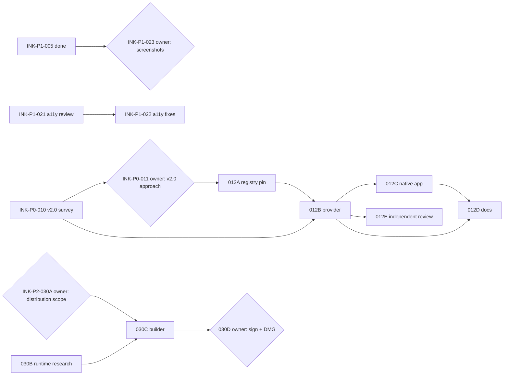

# End-to-end roadmap

`python3 scripts/tickets.py list` is the live status; this page explains the order.
Prefix: `INK`. The product goal is in [PRODUCT.md](../PRODUCT.md): a native macOS app
that keeps the latest CrossInk release editable on every XTEINK reader in scope,
alongside the released migration CLI, with honest validation labels.

## Where things stand

- Done: v1.0.0 migration CLI (INK-P0-001); native app with v1.6.1 editing and
  complete backups (INK-P0-002); pinned release registry with v1.6.0/v1.5.1 subsets
  and backup-only access (INK-P0-003); UI clarity and polish (INK-P1-004, INK-P1-005);
  PR description standard (INK-P1-006).
- In progress: this workflow installation (INK-P1-007, in review). No other open
  branches, PRs, issues or uncommitted work existed when the backlog was written.
- New upstream: CrossInk published **v2.0.0-RC on 2026-11-04**. Readers that update
  are backup-only in InkKit until the contract is reviewed. That makes the v2.0
  review the critical path, because the support focus is keeping the latest
  release editable ([firmware support](../docs/firmware-support.md)).
- Pending evidence: complete-snapshot workflow on hardware, all non-X3 models,
  keyboard/VoiceOver/minimum-size/light-mode review, Intel, clean-Mac and macOS 14.
- Not started: signed public distribution. The app remains a local development build.

## Phases

| Phase | Outcome | Tickets |
|---|---|---|
| 1. CrossInk v2.0 | v2.0 readers are pinned, then editable within the decided scope | INK-P0-010, INK-P0-011, INK-P0-012 (A–E) |
| 2. App quality and evidence | Docs match the registry; accessibility reviewed and fixed; screenshots current; X3 snapshot acceptance recorded | INK-P1-020 to INK-P1-024 |
| 3. Next release | Owner chooses what the next tag contains | INK-P1-025 |
| 4. Public distribution | Production runtime, signed and notarized DMG | INK-P2-030 (A–D) |
| 5. Wider hardware evidence | Reviewed reports for X4, X4 Classic, X4 Pro | INK-P2-031 |

## Dependency graph

`{}` nodes need an owner decision or approval.

## Parallel lanes

Tickets in different lanes share no exclusive resource, so different agents can
work them at the same time. Work inside a lane is sequential.

| Lane | Resources | Now | Next |
|---|---|---|---|
| A. Firmware contract | `crossink-contracts`, `inkkit-schema`, `inkkit-codec`, `crossink-profile`, `firmware-docs`, `config-docs` | INK-P0-010 (read-only) | INK-P0-011 owner → 012A → 012B → 012E, 012C → 012D |
| B. Docs alignment | `macos-docs` | INK-P1-020 | — |
| C. App quality | `macos-app` (shared with 012C) | INK-P1-021 (read-only) | INK-P1-022; serialize with 012C |
| D. Distribution | `macos-build`, `release-pipeline` | INK-P2-030B (read-only) | INK-P2-030A owner → 030C → 030D |
| E. Owner-run evidence | `validation-docs`, `screenshots`, `publication-guard` | — (gated) | INK-P1-023, INK-P1-024, INK-P2-031 |

Suggested split today:

1. Frontier or standard agent: **INK-P0-010** (critical path).
2. Standard agent: **INK-P1-021**.
3. `any`-tier agent: **INK-P1-020**.
4. Standard agent: **INK-P2-030B**.

All four are read-only or touch disjoint resources.

## Owner actions that unlock more parallel work

1. After INK-P0-010: answer **INK-P0-011** (which v2.0 tag, editing scope). Unlocks
   all of INK-P0-012; 012B and 012C can then overlap with lane C if 012C waits for
   INK-P1-022 or vice versa.
2. Approve **INK-P1-023** (screenshot refresh with visual/privacy review).
3. Run the X3 complete-snapshot checks for **INK-P1-024** and report the results.
4. Answer **INK-P1-025** (next release scope) and **INK-P2-030A** (signing account,
   architectures, macOS minimum, updates).
5. Choose an evidence source for **INK-P2-031**.

## Isolation notes

The survey found no fixed ports, databases, Docker/Compose projects, queues or
shared caches in tests or tools. Test files live in per-test temporary directories,
and the preview builder and Swift module cache write under each worktree's `work/`.
The app's private recovery storage under the user's Application Support folder is
deliberately not redirectable (a safety guard), so no ticket makes it configurable;
see Gotchas in [README.md](README.md).

## Priority changes and mapping

- There were no GitHub issues, TODO files or open branches to migrate. Planned items
  come from the "pending" and "separate work" statements in PRODUCT.md,
  docs/macos-preview.md, docs/compatibility.md and docs/firmware-support.md.
- New-release review is P0, following the documented support focus. Older
  backup-only releases get no editors (firmware-support.md), so there is no ticket.
- Public distribution stays P2: PRODUCT.md calls it separate maintainer work.
